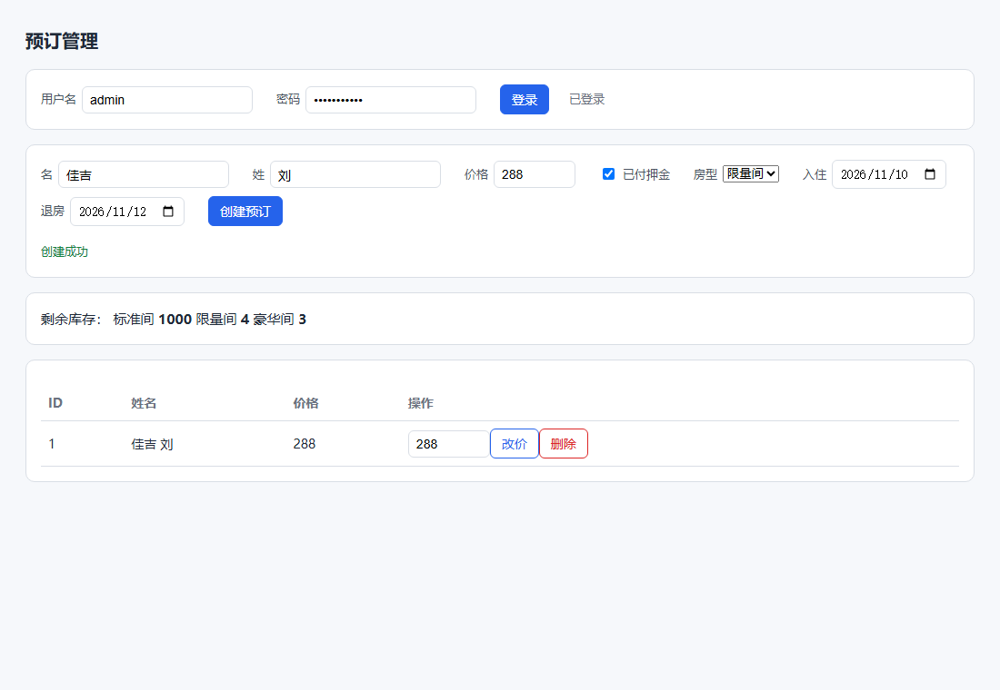
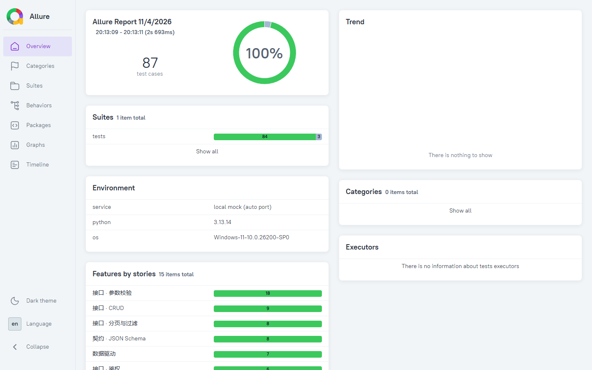
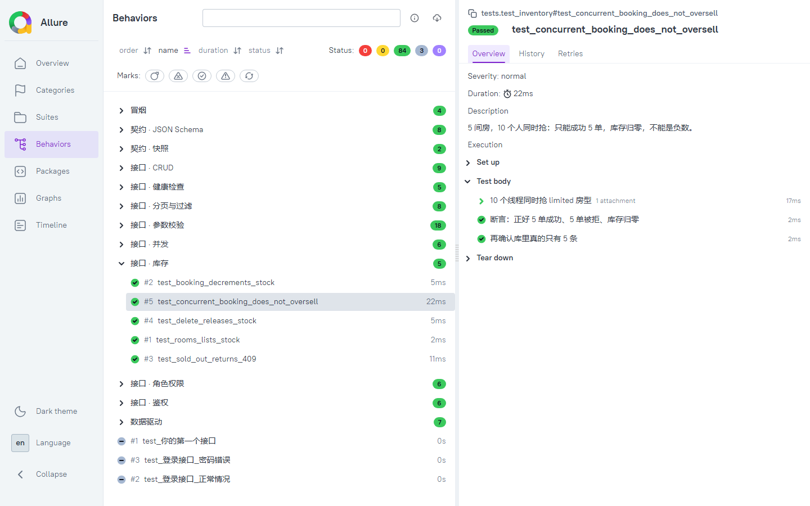

# 软件测试可视化

接口自动化 + UI 自动化练习项目：**pytest + requests + Playwright**，接口 87 个用例、UI 6 个用例，覆盖正常流程、异常边界、并发安全、契约规则、角色越权、分页边界、库存超卖、浏览器端主流程，并自带零依赖的指标工具（报告 / 覆盖率 / 失败现场留存）。

配套文档：**[测试方案](docs/测试方案.md)**（范围 / 策略 / 等价类 / 边界值 / 判定表 / 用例清单）、**[缺陷记录](docs/缺陷记录.md)**（4 个缺陷的完整缺陷单）。

## 为什么自带一个 mock 服务

原本想用 [restful-booker](https://github.com/mwinteringham/restful-booker) 做靶场，但它部署在 Heroku 免费实例上——

```
$ curl https://restful-booker.herokuapp.com/booking
HTTP 000
```

已经连不上了。所以 `mock_server.py` 用标准库实现了一份**同形状**的接口（鉴权、CRUD、400/401/403/404 语义齐全），离线也能跑，不受别人服务器影响。

## 目录

```
软件测试可视化/
├─ mock_server.py          本地 API（只用标准库，线程安全）
├─ conftest.py             pytest 夹具：起服务、鉴权、造数据、清数据
├─ retry.py                失败重试插件（零依赖，给 flaky 用例用）
├─ coverage_simple.py      语句覆盖率（零依赖，sys.settrace）
├─ assertions.py           失败信息更清楚的断言库
├─ contract.py             生成 / 比对契约快照
├─ schema_validator.py     JSON Schema 校验（零依赖，规则级契约）
├─ reports.py              report.xml → 自包含 HTML 报告
├─ scanner.py              图形化体检器（静态检查 + 跑测试）
├─ tests/
│   ├─ test_health.py      健康检查与路由（5 个）
│   ├─ test_auth.py        鉴权（6 个）
│   ├─ test_crud.py        增删改查主流程（9 个）
│   ├─ test_validation.py  参数校验与边界（18 个）
│   ├─ test_smoke.py       冒烟层（4 个）
│   ├─ test_data_driven.py 数据驱动（7 个）
│   ├─ test_contract.py    契约快照（2 个）
│   ├─ test_schema.py      契约规则 / JSON Schema（8 个）
│   ├─ test_roles.py       角色越权（6 个）
│   ├─ test_pagination.py  分页与过滤（8 个）
│   ├─ test_inventory.py   库存与超卖（5 个）
│   └─ test_concurrency.py 并发安全与延迟（6 个）
├─ ui_tests/
│   ├─ conftest.py         Playwright 夹具：浏览器 + 独立上下文 + 失败截图
│   └─ test_booking_ui.py  UI 主流程（6 个）
├─ web/index.html          管理页面（登录 / 新建 / 改价 / 删除）
├─ schema/                 契约规则（JSON Schema，4 份）
├─ artifacts/              失败现场（截图 / trace），不进版本库
├─ docs/
│   ├─ 测试方案.md          范围、策略、等价类/边界值/判定表、用例清单
│   └─ 缺陷记录.md          4 个缺陷的标准缺陷单
├─ data/booking_cases.json 数据驱动用例表
├─ snapshots/              契约快照
├─ examples/               演示用的"偶发失败"用例（默认不跑）
├─ pytest.ini
├─ requirements.txt        依赖：pytest / requests / allure-pytest
├─ requirements-ui.txt     UI 层依赖（playwright）
└─ 运行测试.bat / 安装UI依赖.bat / 运行UI测试.bat / 生成Allure报告.bat / 一键测试.bat
```

## 跑起来

```bash
pip install -r requirements.txt
python -m pytest
```

Windows 上也可以双击 `运行测试.bat`。

实测输出：

```
collected 87 items
...
==================== 84 passed, 3 skipped in 2.60s ====================
```

（跳过的 3 个是 `test_my_api_template.py` 里的模板用例，删掉 `@pytest.mark.skip` 就会执行。）

UI 层要另装浏览器，单独跑：

```
python -m pytest ui_tests -q
6 passed in 2.55s
```

## 覆盖了什么

| 类别 | 测的点 |
|---|---|
| 健康检查 | ping 通不通、返回体、Content-Type、未知路由 404 |
| 鉴权 | 正确凭据换 token、错误密码 401、缺 token / 错 token 403 |
| CRUD | 创建返回 ID、创建后能查、出现在列表、PUT 全量更新、PATCH 只改指定字段、删除返回 201、删完 404、重复删除 404 |
| 参数校验 | 缺字段、`depositpaid` 非布尔、`totalprice` 非数字或负数、日期格式非 ISO、非法日期、同日入住退房、闰日、`bookingdates` 缺键、查不存在的资源 404 |
| 契约 | 字段类型快照（`contract.py`）+ JSON Schema 规则：必填、价格 ≥ 0、日期必须真实存在、不允许多余字段 |
| 角色权限 | admin 可写、viewer 只读；viewer 的增/改/删都要 403，且数据不能被改动 |
| 分页 | 首页 / 第二页 / 最后一页不满 / 越界页空列表 / size 非法（0、-1、101）/ 按房型过滤 |
| 库存 | 下单扣库存、售罄 409、删除退还、10 线程抢 5 间房不超卖 |
| 并发 | 10 线程并发建 30 条不重号、不丢数据、改不同单子互不干扰、重复删除只成功一次、健康检查延迟 < 200ms |
| UI | 页面加载、登录解锁创建、创建后列表可见、空名字显示后端错误、改价、删除 |

**参数化用例**（`@pytest.mark.parametrize`）一个函数覆盖多个边界值，所以 93 个用例其实只用了 75 个测试函数。

## 几个值得注意的设计

1. **每个用例前清空数据**（`autouse` 夹具）——否则用例执行顺序会影响结果，出现"单跑过、全跑挂"。
2. **造数据的夹具负责善后**——`yield` 之后自动删除，不靠用例自己清理。
3. **端口用 0** 让系统分配，避免和本机其他服务抢端口。
4. **等 `/ping` 通再开始测**，不靠 `sleep` 赌时间。

## 能力清单（已完成 / 没做）

- [x] 本地 mock 服务 + 分层用例（冒烟 / 回归）
- [x] 数据驱动用例（`data/booking_cases.json`）
- [x] 契约快照（字段类型变了就红）
- [x] JSON Schema 规则契约（必填 / 范围 / 真实日期，零依赖校验器）
- [x] 零依赖 HTML 报告（`reports.py`）
- [x] GitHub Actions 五关流水线（静态 → 冒烟 → 回归矩阵 → 覆盖率 → UI）
- [x] 失败重试（`retry.py`，只给 flaky 用例开）
- [x] 并发用例 + 零依赖语句覆盖率（94.1%）
- [x] 角色权限（admin / viewer）与越权用例
- [x] 分页、过滤与边界用例
- [x] 房间库存 + 并发超卖用例
- [x] Playwright UI 层（`ui_tests/`，6 条主流程）
- [x] 失败现场留存（截图 + trace，CI 自动上传 artifact）
- [x] 测试方案 + 缺陷记录文档（`docs/`）
- [x] Allure 富报告（Temurin JDK 25 + Allure CLI 2.46.1，本机已装）

## License

MIT

## 测试工作流

一套能日常用的流程，不只是"跑一下看看"。

```
写用例  →  冒烟先跑（-m smoke）  →  全量回归  →  出报告  →  看红字定位  →  修
                                        ↑                              ↓
                                     CI 每次提交自动跑  ←───────────────┘
```

### 1. 分层：冒烟 / 回归

用例打了标记（`pytest.ini` 里声明），可以分开跑：

```bash
pytest -m smoke            # 只跑冒烟（4 个，0.5s）—— 服务挂了立刻知道
pytest -m "not smoke"      # 跳过冒烟，只跑细节
pytest -m regression       # 回归组
```

**为什么分层**：CI 上先跑冒烟，挂了就不用浪费时间跑后面几百个用例。

### 2. 断言要能"说清哪不对"

`assertions.py` 提供四个helper，失败时会把实际响应体打出来：

```python
from assertions import assert_status, assert_json_field, assert_fields_present, assert_error_message

assert_status(response, 200, "创建预订")          # 失败会带上响应体
assert_fields_present(body, ["token"], "登录返回")  # 缺字段会说缺哪个
assert_error_message(response, "Bad credentials")  # 错误信息里必须有原因
```

对比一下：

| 写法 | 失败时你看到 |
|---|---|
| `assert r.status_code == 200` | `assert 500 == 200` ← 还得自己复现 |
| `assert_status(r, 200, "创建预订")` | 状态码 + 请求 URL + 响应体 ← 直接定位 |

### 3. 一键跑 + 出报告

双击 `一键测试.bat`：跑全量 → 生成 HTML 报告 → 自动开浏览器。

### 4. CI

`.github/workflows/test.yml` 在 push 时跑三个 Python 版本（3.11/3.12/3.13）。


### 5. 数据驱动用例

测试场景写在 `data/booking_cases.json` 里，加一行就是加一个用例，不用改代码：

```json
{"id": "价格为0", "payload": {...}, "expect": 200}
```

`tests/test_data_driven.py` 读这个文件，用 `@pytest.mark.parametrize` 展开。

### 6. 契约快照

`contract.py` 记录响应里每个字段的**类型结构**，结构变了就失败：

```
snapshots/create_booking.json
{ "booking": { "bookingdates": {"checkin": "str", ...}, "totalprice": "int" }, "bookingid": "int" }
```

**为什么需要**：后端把 `totalprice` 从数字改成字符串，功能断言可能照样过，但前端会炸。契约测试专盯这个。

```bash
python contract.py          # 重新生成快照（确认改动是预期的）
pytest tests/test_contract.py
```

### 7. 切换被测服务

默认跑本地 mock。要测真实服务就设环境变量：

```powershell
$env:API_BASE_URL = "http://127.0.0.1:8000"
python -m pytest
```

### 8. 失败重试（治理 flaky 用例）

CI 里最烦的不是"一直红"，而是"有时红有时绿"——这类用例叫 **flaky**（偶发失败）。
`retry.py` 是项目自带的零依赖重试插件（不需要 `pytest-rerunfailures`）：

```python
@pytest.mark.flaky(reruns=2, delay=0.3)
def test_第三方接口():
    ...
```

重试**只对打了标记的用例生效**，跑完会单独打印"重试记录"，点名谁靠重试才过的：

```
  RERUN tests/test_x.py::test_y：第 1 次没通过，0.3s 后重试
------------------------ 重试记录 ------------------------
  tests/test_x.py::test_y  重试 1 次后通过
  共 1 个用例靠重试变绿 —— 记下来查根因，别长期留着
```

**为什么不能全局重试**：重试会掩盖真缺陷，还会拖慢 CI。正确顺序是：先查是不是用例自己的问题（等待时间不够、依赖了执行顺序、共享数据没清），确认是外部抖动才加标记，并把它记进待办。

想看效果：`python -m pytest examples/ -q`（两条故意偶发失败的用例，默认不在回归里跑）。

### 9. 并发安全

`tests/test_concurrency.py` 用线程池同时打 10 个请求，守四类 bug：

| 场景 | 断言 | 打中的是哪类 bug |
|---|---|---|
| 并发创建 30 条 | ID 不重复、列表正好 30 条 | 发号没加锁 → 两张单拿到同一个号 |
| 并发读 | 读到的条数稳定 | 读写同一份数据没隔离 |
| 并发改不同单子 | 互不串数据 | 共享状态写错 |
| 并发删同一条 | 只有 1 个返回 201 | "先查再删"两步之间被插队 |

写这组用例时顺手审出 mock 的 `do_DELETE` 是"先查在不在、再删"两步——实测 240 次并发删除没撞上（窗口只有几微秒），但结构上就是错的，已改成一把锁里的原子 `pop`。**代码审查能发现的问题，别等线上发生。**

### 10. 覆盖率（零依赖）

`python coverage_simple.py` 用标准库 `sys.settrace` 统计 `mock_server.py` 的语句覆盖：

```
被测文件: mock_server.py
可执行行: 273    已覆盖: 257    覆盖率: 94.1%
未覆盖的行: 82-83、134、168-169、334-343、347
```

- **分母** = 编译后字节码里的可执行行（不是"文件共多少行"）；
- **分子** = 跑完接口场景后真正执行过的行；
- `123-124` 是"页面文件缺失"的兜底分支，`229-238` 是命令行入口 `main()`，都属于正常走不到的行。

CI 里带 `--min 90`，覆盖率掉下去流水线直接红。

### 11. UI 层（Playwright）

接口通了不代表用户能用——按钮没绑事件、字段渲染错位，接口测试一个都发现不了。
所以给 mock 配了一个管理页面 `web/index.html`（原生 HTML + JS，无构建步骤），
再用 Playwright 从浏览器里点它：



**最省事的装法**：双击 `安装UI依赖.bat`（自动装包 + 下载浏览器），装完双击 `运行UI测试.bat`。

命令行装法：

```bash
pip install -r requirements-ui.txt      # 装 playwright
python -m playwright install chromium   # 下载浏览器（约 300MB，只需一次）
python -m pytest ui_tests -v
```

> `运行UI测试.bat` 会先自检：没装 playwright 或浏览器没装好时，它会直接告诉你缺什么、该双击哪个文件，不会一闪而过。

用例覆盖：页面加载（未登录时创建按钮禁用）→ 登录解锁 → 创建后列表出现 →
空名字提交显示后端错误 → 改价生效 → 删除后行消失。

**两个关键写法**

1. **自动等待**：用 `expect(locator).to_have_text(...)` 而不是 `assert page.text_content(...)`——
   `expect` 会轮询到超时，页面还没渲染完也不会误报，不用写 `time.sleep`。
2. **每个用例独立 context**：cookie / 存储隔离，用例之间不会串登录态。

**失败时自动留证据**：用例红了会往 `artifacts/ui/` 写两样东西——

```
artifacts/ui/test_change_price_updates_the_row-20261104-194148.png   失败瞬间整页截图
artifacts/ui/test_change_price_updates_the_row-20261104-194148.zip   Playwright trace
```

截图能直接看出"卡在哪个状态"，trace 可以逐步回放：

```bash
python -m playwright show-trace artifacts/ui/xxx.zip
```

CI 里 UI 关失败时会把这个目录作为 artifact 上传，不用在本机复现。

> UI 用例放在 `ui_tests/` 而不是 `tests/`：默认 `pytest` 不加载浏览器，没装 Playwright 的机器照样能跑接口用例。CI 里 UI 是单独一关（第 4 关）。

### 12. 契约升级：JSON Schema（零依赖）

`contract.py` 的快照只能证明"结构没变"，管不了"值合不合法"——`totalprice: -1` 类型仍是数字，快照照样通过。
`schema_validator.py` 补上规则级契约，用 4 份 schema 描述"什么样的响应才算合法"：

| schema | 管什么 |
|---|---|
| `booking.schema.json` | 5 个字段必填、价格 ≥ 0、日期必须是真实存在的 YYYY-MM-DD、不许多字段 |
| `booking_created.schema.json` | `bookingid` 为正整数 + `booking` 复用上面的定义（`$ref`） |
| `booking_list.schema.json` | 数组，每项只有 `bookingid` |
| `error.schema.json` | 错误响应必须有非空 `error` 字段 |

```bash
python -m pytest tests/test_schema.py -v
```

校验器只有 100 多行，支持 `type / required / properties / items / enum / minimum / maximum / minLength / format(date) / $ref`，
报错会一次性列出所有问题：

```
SchemaError: 契约不符：
  - 创建响应.booking.totalprice: 不能小于 0，实际 -1
  - 创建响应.booking.bookingdates.checkin: 不是真实存在的日期，实际 '2026-13-45'
```

**为什么自己写而不用 jsonschema 包**：这个项目坚持"不装包也能跑"，而且校验器本身也当教学材料——
面试被问"什么是契约测试"时，能说清快照和规则的区别，比背定义强。

### 13. Allure 报告（需要 Java）

Allure 能出"用例分组、步骤、附件、趋势"的富报告，代价是要 Java 运行时。本机已装好：

| 组件 | 位置 | 说明 |
|---|---|---|
| Temurin JDK 25 | `D:\tools\jdk-25.0.5+8` | 免安装 zip，用户级；`JAVA_HOME` 已设 |
| Allure CLI 2.46.1 | `D:\tools\allure-2.46.1` | 解压版，`bin` 已加进用户 PATH |
| allure-pytest | pip 包 | 已并入 `requirements.txt` |

```powershell
python -m pytest --alluredir=allure-results -q
allure serve allure-results      # 起服务并自动开浏览器
```

也可以双击 `生成Allure报告.bat`（会先检查 JAVA_HOME 和 allure 是否就绪）。



**报告里有什么，全靠这几行标注撑起来**：

| 标注 | 用在哪 | 报告里看到的效果 |
|---|---|---|
| `allure.feature("接口 · CRUD")` | 每个测试文件顶部（`pytestmark`） | Behaviors 视图按业务分组，一眼看出哪块测得多 |
| `@allure.story("创建预订")` | 关键用例 | 同一个 feature 下再按场景分层 |
| `@allure.severity(CRITICAL)` | 核心用例 | 报告里标出严重级别，能按级别筛 |
| `with allure.step("POST /booking 创建一条预订")` | 多步骤用例 | 报告里展开成执行步骤，失败停在哪一步一目了然 |
| `allure.attach(response.text, ...)` | 关键断言前 | 响应体直接挂在报告里，不用回头复现 |
| UI 失败截图 | `ui_tests/conftest.py` | 失败用例详情页直接看图 |
| `environment.properties` | `conftest.py` 自动写 | 报告 Environment 区块显示服务地址 / Python / 系统 |



**VS Code 能装 JDK 吗**：VS Code 本身不装 JDK，是"Extension Pack for Java"扩展会提示下载一个，需要你在窗口里点确认。这次改用命令行装了免安装版（不需要管理员）；以后要写 Java，在 VS Code 里装 Java 扩展、把 `java.jdt.ls.java.home` 指向 `D:\tools\jdk-25.0.5+8` 就能复用同一个 JDK。

**环境坑（已修复）**：机器 PATH 里曾有一条 2021 年 Oracle 残留的 `C:\Program Files\Common Files\Oracle\Java\javapath`，指向已删除的 JRE、又排在用户 PATH 前面，导致直接敲 `java -version` 会崩（0xC0000005）。已用管理员脚本 `D:\tools\fix-java-path.ps1` 删掉该条目，并把 `D:\tools\jdk-25.0.5+8\bin` 放到机器 PATH 首位（原 PATH 备份在 `D:\tools\machine-path-backup.txt`，可回滚）。**新开的窗口**里 `java -version` 已正常；已经开着的终端 / VS Code 要重启才能读到新 PATH。

### 14. 业务模型升级：角色 / 分页 / 库存

只测 CRUD 练不出真本事，所以给 mock 加了三样真实系统才有的东西（纯标准库，无外部依赖）：

| 能力 | 入口 | 关键行为 |
|---|---|---|
| 角色权限 | `POST /auth` 用 admin / viewer 两个账号 | admin 可写，viewer 只读；写操作越权返回 403 |
| 分页与过滤 | `GET /booking?page=1&size=10&roomtype=limited` | 带 `page/size` 返回信封 `{items,total,page,size}`，不带则保持数组（向后兼容） |
| 房间库存 | `GET /rooms`、`POST /booking?roomtype=limited` | 下单扣库存、售罄 409、删除退还 |

**这三个能力各自撞出了一个真实缺陷**（详见 `docs/缺陷记录.md`）：

- **越权**：admin 校验只写在了"创建"上，viewer 居然能 PUT / PATCH / DELETE → 测试抓红 → 四个写接口统一走 `_admin_only()`；
- **超卖**：库存是"先查、再扣"两步，10 个线程抢 5 间房卖出了 9 间 → 改成锁内一次性 `reserve()`。

超卖那条不是靠碰运气：mock 里用 10ms 模拟"查库存要访问数据库"的耗时，竞态窗口才真实存在；修完之后延迟去掉，套件仍然 3 秒内跑完。

```powershell
python -m pytest tests/test_roles.py tests/test_pagination.py tests/test_inventory.py -v
```

## 这个项目自己发现过六个问题

写完数据驱动用例后，**测试立刻抓到 mock 服务的两个真实缺陷**：

| 缺陷 | 症状 | 修复 |
|---|---|---|
| 空名字能创建 | `firstname: ""` 返回 200 | `validate()` 加非空检查 |
| 假日期能通过 | `2026-13-45` 被接受 | 正则只管位数，改用 `datetime.strptime` 真校验 |

补充 `checkout > checkin` 规则后，用例从 2 failed 变成全绿。

第三个问题是写并发用例时审出来的：`do_DELETE` 里"先查在不在、再删"不是原子操作（见第 9 节），已经改成一把锁里完成。

第四个问题是补"等价类划分"时发现的：`totalprice` 只校验了类型没校验范围，**负数价格也能创建**。
补用例 → 变红 → 加一行范围校验 → 变绿（详细过程见 `docs/缺陷记录.md` 的 BUG-004）。

第五、六个问题是升级业务模型时撞出来的：**viewer 能删数据**（越权）和**10 人抢 5 间房卖出 9 间**（超卖）。前者是"校验写漏了一个接口"，后者是"锁只加了一半"，都是真实项目里最常见的两类错。

**这就是测试的价值**——不是"证明代码是对的"，是"在它错的时候立刻知道"。

## 还能加什么

- [ ] 用 `pytest-xdist` 把用例并行跑（现在 3 秒，收益不大，属于扩展练习）
- [ ] 把 `API_BASE_URL` 指向一个真实后端，验证"同一套用例换环境能跑"

